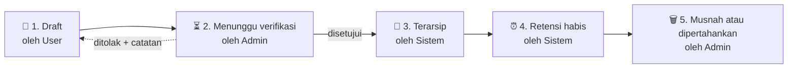

<div align="center">

# 🗂️ Sistem Arsip Dokumen

### PT Sucofindo (Persero) Cabang Cilacap

**Simpan, cari, dan kendalikan dokumen perusahaan dalam satu sistem.**


</div>

---

## 📌 Tentang Sistem

Sistem ini dipakai untuk **menyimpan, mencari, dan mengendalikan dokumen** di PT Sucofindo (Persero) Cabang Cilacap.

Ada dua peran:

| | Peran | Tugas |
|:---:|---|---|
| 🛡️ | **Admin** | Mengelola arsip: memverifikasi unggahan, mengatur klasifikasi, dan memutuskan nasib dokumen |
| 👤 | **User** | Mencari dokumen dan mengunggah dokumen baru |

## 🎯 Tujuan

Empat hal yang harus bisa dilakukan sistem sejak versi pertama:

| | Tujuan | Penjelasan |
|:---:|---|---|
| 📚 | **Satu tempat untuk semua dokumen** | Laporan hasil uji, kontrak, SOP, sertifikat kalibrasi, dan berita acara tidak lagi tersebar di folder pribadi |
| 🔎 | **Mudah ditemukan** | Cari lewat nomor, judul, kategori, klasifikasi, dan tahun |
| 🔐 | **Akses terkendali** | Dokumen *Rahasia* hanya dibuka oleh yang berhak, dan setiap unduhan tercatat di log |
| ⏰ | **Masa simpan jelas** | Sistem memberi tanda saat masa retensi hampir habis, supaya Admin bisa memutuskan nasib dokumen |

## 🔄 Siklus Dokumen

Setiap dokumen melewati **lima status**. Urutan ini menjadi dasar fitur verifikasi dan retensi.



| # | Status | Oleh | Yang terjadi |
|:---:|---|:---:|---|
| 1 | 📝 **Draft** | User | Mengisi data dan memilih berkas. Belum dikirim, belum bernomor |
| 2 | ⏳ **Menunggu verifikasi** | Admin | Admin memeriksa kelengkapan, kategori, dan klasifikasi. Unggahan bisa ditolak dengan catatan |
| 3 | 📁 **Terarsip** | Sistem | Dokumen mendapat nomor resmi dan lokasi arsip fisik, lalu bisa dicari semua yang berhak |
| 4 | ⏰ **Retensi habis** | Sistem | Dokumen yang lewat masa simpan aktif ditandai dan muncul di dasbor Admin |
| 5 | 🗑️ **Musnah / dipertahankan** | Admin | Admin memutuskan. Keputusan dan alasannya masuk log |

> 💡 Unggahan yang ditolak kembali ke User bersama catatan perbaikan, lalu bisa dikirim ulang.

## 🔢 Penomoran Dokumen

Nomor dibuat **otomatis** saat Admin menyetujui dokumen, jadi draft yang batal tidak membuat urutan berlubang.

```text
   LHU   /   CLC   /   2026   /   0412
```

| Bagian | Arti |
|:---:|---|
| `LHU` | Kode kategori |
| `CLC` | Kode cabang |
| `2026` | Tahun arsip |
| `0412` | Urutan per kategori dan tahun |

## 🧱 Modul

| | Modul | Fungsi |
|:---:|---|---|
| 🔎 | **Pencarian dan penelusuran** | Kata kunci, filter kategori, klasifikasi, unit, dan tahun |
| 📤 | **Unggah dan versi** | Berkas baru, revisi dengan nomor versi, dan sidik berkas untuk mengecek keutuhan |
| ✅ | **Verifikasi** | Antrean unggahan untuk Admin, dengan tombol setujui atau tolak beserta catatan |
| 🔐 | **Klasifikasi dan hak akses** | Aturan siapa boleh melihat apa, berdasarkan peran dan klasifikasi dokumen |
| ⏰ | **Retensi dan pemusnahan** | Penanda masa simpan, daftar dokumen jatuh tempo, dan berita acara pemusnahan |
| 🧾 | **Log audit** | Siapa mengunggah, membuka, mengunduh, mengubah, atau menghapus, dan kapan |

## 🧩 Layanan

Dokumen dikelompokkan berdasarkan 5 layanan:

| 🧪 Pengujian | 🔎 Inspeksi | 📜 Sertifikasi | 🎓 Pelatihan | 💼 Konsultansi |
|:---:|:---:|:---:|:---:|:---:|

Setiap layanan punya jenis dokumen sendiri, misalnya **Laporan Hasil Uji** untuk Pengujian atau **Kontrak** untuk Konsultansi.


</details>

---

<div align="center">

**PT Sucofindo (Persero) Cabang Cilacap** 

</div>